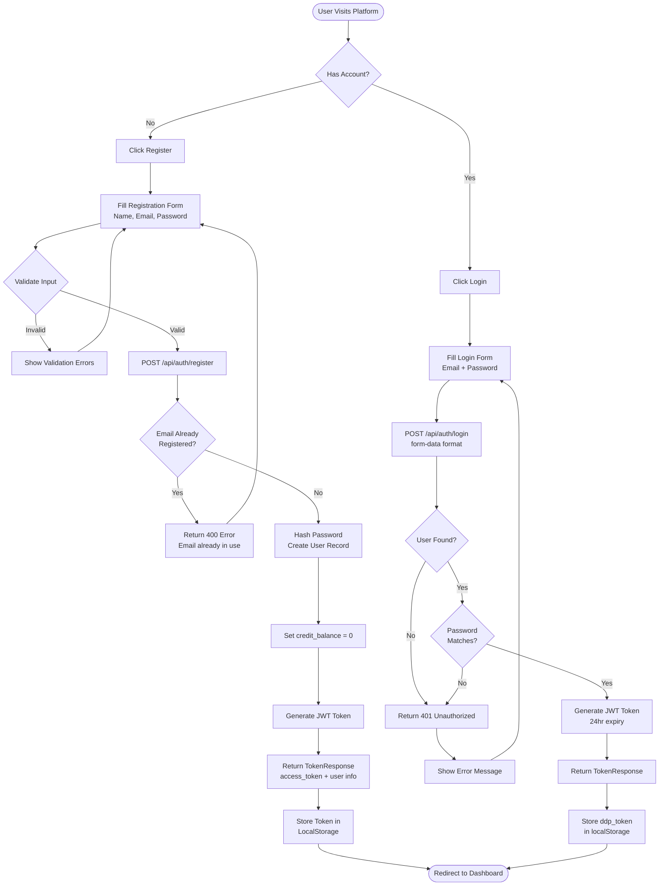
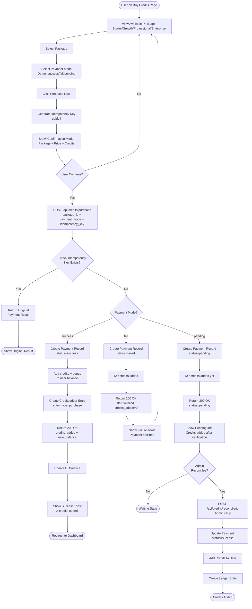
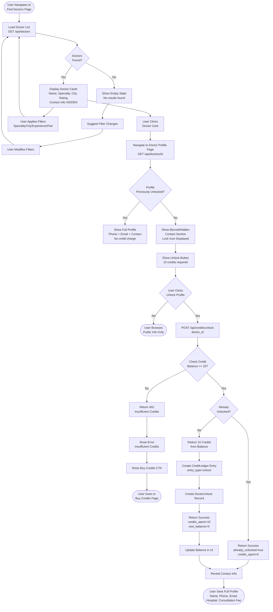

# Workflow Diagrams
## Doctor Data Platform — Multiplier AI Assessment (Task 3)

**Document Version:** 1.0  
**Date:** November 2026  

---

## Diagram 1 — User Registration & Login Flow

---

## Diagram 2 — Credit Purchase Flow

---

## Diagram 3 — Doctor Search & Profile Unlock Flow

---

## Diagram Summary

| Diagram | Key Decision Points | Business Rules Covered |
|---------|--------------------|-----------------------|
| Registration & Login | Email uniqueness, password validation, JWT expiry | BR-001 |
| Credit Purchase | Idempotency, payment modes (SC-002, SC-003, SC-005) | BR-007, BR-008, BR-009, BR-010 |
| Doctor Search & Unlock | Empty results (SC-004), insufficient credits (SC-001) | BR-003, BR-004, BR-005, BR-006, BR-011, BR-012 |

---

*Document End — Doctor Data Platform Workflow Diagrams v1.0*
